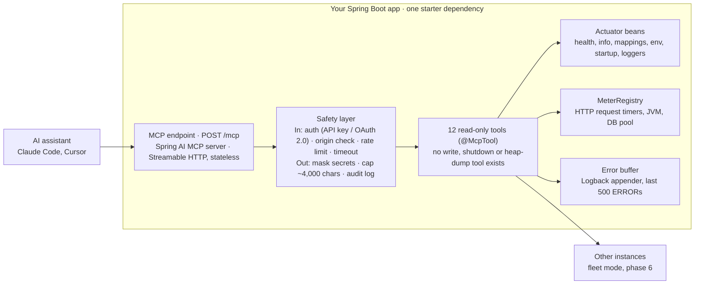

# Bootscope: design plan

MCP server starter for Spring Boot. Copied from the design doc on 19 Nov 2026
(source of truth: https://claude.ai/artifact/Px7pPjXqSf55MXo4SXrv5N). If the two differ, ask the
user which one is current.

## Goal and users

A Spring Boot starter that, with one dependency, lets an AI assistant (Claude, Copilot, Cursor)
**safely inspect a running Spring Boot app from the inside** through MCP: health, metrics, slow
endpoints, recent errors, configuration and startup. Read-only by default, secrets masked, every
call audited. There is no AI inside the starter: it only exposes tools; the assistant is the AI.

**Who uses it**

- **Backend developers** debugging locally or in a dev/staging environment from their AI coding assistant.
- **On-call engineers** asking "what's wrong right now?" across several services.
- **Platform teams** who want one approved, auditable way for AI tools to read production-like
  systems, instead of people pasting logs and Actuator JSON into chats.

**Questions it should answer**

- "Why is `/orders` slow right now?" → slowest endpoints, p95 latency, error rate, DB pool usage.
- "Is the app healthy? Which dependency is down?" → health components and their details.
- "What errors started after the last deploy?" → recent exceptions grouped by type, with first and last seen.
- "Which config value is active for `payment.timeout`, and where did it come from?" → property source, masked if secret.
- "Why did startup take 40 seconds?" → slowest beans and auto-configurations.
- "Which of my 5 services is erroring?" → fleet view (later phase).

**Success criteria for v1.0**

- Added with one dependency and two properties; works on a fresh Spring Boot app in under 5 minutes.
- No secret ever appears in a tool response (tested); no write or shutdown action is reachable by default.
- Every response fits a small budget (default about 4,000 characters), so it never floods the AI's context.
- Published on Maven Central with docs, a demo app and a demo GIF.

## Prior art and our twist

**The original idea ("Actuator as MCP tools, in-process, one dependency") already exists.** A Java
starter that exposes Actuator endpoints as MCP tools from inside the app was merged on
3 Oct 2026. So Bootscope must stand out on **diagnosis, safety and fleet**, not on "expose Actuator".

| Project | What it does | Gap we fill |
| --- | --- | --- |
| [spring-boot-actuator-mcp-starter](https://github.com/alexmond/spring-boot-actuator-extensions/pull/12) (alexmond, Java) | Maps chosen Actuator endpoints 1:1 to MCP tools at `/actuator/mcp`; read and write follow Actuator access settings; Actuator masking; origin check; Spring AI 2.0.1 transport + MCP Java SDK 2.0.0 | Raw endpoint dumps, not answers; write tools possible; no auth beyond origin checks described; no audit, no multi-service view |
| [spring-runtime-mcp](https://pypi.org/project/spring-runtime-mcp/) (Python) | Separate process reading Actuator and OpenAPI; 8 bounded, read-only, secret-free tools | Needs Python beside the app; outside view only |
| [Spring Toolkit MCP](https://glama.ai/mcp/servers/giaffa86/spring-toolkit-mcp) (Python) | Repo inspection + runtime Actuator for several named apps; mutations behind flags | External process; repo review focus |
| [mcp-spring-boot-actuator](https://github.com/Dmitriusan/mcp-spring-boot-actuator) (npm) | Analysed pasted Actuator JSON | End of life since 10 May 2026 |
| Spring AI itself | Building blocks: `@McpTool` annotations, MCP server starters, MCP Security (OAuth 2.0 + API keys, WebMVC only) | A toolkit, not a ready diagnostics product |

**Our twist: a diagnostics assistant, not an endpoint mirror.**

1. **Answer-shaped tools:** `slowest_endpoints`, `recent_errors`, `whats_wrong_now` compute and
   summarise (p95 latency, error rates, grouped exceptions) instead of returning raw Actuator JSON.
   Two tools need data Actuator doesn't keep: a recent-errors buffer and a deploy marker.
2. **Read-only by design:** no write, shutdown or heap-dump tool exists at all.
3. **Secure by default:** real authentication (OAuth 2.0 or API key via Spring AI MCP Security),
   an audit log of every call, rate limits, output budgets.
4. **Fleet mode:** one MCP endpoint that answers across several services and instances.
5. **Current protocol:** Boot 4 adapter targets MCP's 2026-07-28 stateless revision ("Modern"
   servers in Spring AI 2.1) once available; 2025-11-25 stateless otherwise.

**Decided (19 Nov 2026): build our own starter, named Bootscope**, rather than contribute to
alexmond's project.

Versions checked 19 Nov 2026: Spring Boot 4.1.0 latest stable; Spring AI 2.0.2 latest stable for
Boot 4 (2.1 in development, with the 2026-07-28 "Modern" server); MCP Java SDK 2.0.0; MCP spec
2026-07-28 current. For Boot 3 apps: Spring AI 1.1.8 runs on Spring Boot 3.5.15 with MCP Java SDK
0.18.3. **Re-check versions before pinning them in the POMs.**

## v1 tool catalogue

Twelve read-only tools; every one reads data in-process from Spring beans (no HTTP calls to the
app's own Actuator).

| Tool | Answers | Data source (in-process) | Risk | Phase |
| --- | --- | --- | --- | --- |
| `app_overview` | What is this app, which version, how long up, which profiles? | `InfoEndpoint` (build and git info), active profiles, JVM runtime | Low | 3 |
| `health_check` | Is it healthy? Which component is down? | `HealthEndpoint`; DOWN components first, details trimmed and masked | Medium | 3 |
| `slowest_endpoints` | Which endpoints are slow? | `MeterRegistry`: `http.server.requests` timers by URI and method (count, mean, max, p95 if histograms on) | Low | 3 |
| `error_hotspots` | Which endpoints return errors? | `http.server.requests` by status (4xx and 5xx counts and rates) | Low | 3 |
| `jvm_snapshot` | Memory, GC, threads under pressure? | Micrometer JVM metrics + thread state counts (no full thread dump) | Low | 3 |
| `api_routes` | Which routes exist and which handler serves them? | `MappingsEndpoint`, paged | Low | 3 |
| `recent_errors` | What errors happened recently, since when, how often? | **New:** Logback appender keeping the last N ERROR events in memory, grouped by exception type and first app stack frame; messages masked | Medium | 4 |
| `whats_wrong_now` | One-call triage | Combines health, error hotspots, slowest endpoints, DB pool (`hikaricp.connections.*`), heap; ranks findings | Medium | 4 |
| `metric_query` | Value of one metric, with tags | `MetricsEndpoint`, allow-listed metric prefixes only | Low | 4 |
| `config_lookup` | Which value is active for a key, and where it comes from? | `Environment` property sources; values masked unless the key is allow-listed | High | 4 |
| `startup_report` | Why was startup slow? | `StartupEndpoint` (needs `BufferingApplicationStartup`) | Low | 4 |
| `log_levels` | Which logger levels are set? | `LoggersEndpoint`, read only | Low | 4 |
| `fleet_status`, `compare_instances` | Across services: who is unhealthy, slow or erroring? | Aggregator calling other instances' MCP endpoints | Medium | 6 |

**Never exposed (not even behind a flag):** shutdown, heap dump, full thread dump, changing log
levels, changing environment, deleting sessions, evicting caches, refresh.

**Every tool response follows one shape:** a one-line summary first, then the top items, then
`truncated: true` with a hint when more exist (for example "call again with `page: 2`"). Default
budget about 4,000 characters.

## Architecture



A tool call enters through the Spring AI MCP endpoint, passes authentication, origin and rate
checks, runs one read-only tool, and comes back masked, size-capped and audited. Tools read
Actuator beans, Micrometer metrics and the error buffer directly, never over HTTP.

## Key design decisions

| # | Decision | Options considered | Choice and why | Trade-off accepted |
| --- | --- | --- | --- | --- |
| 1 | Where it runs | Separate process reading Actuator over HTTP; in-process starter | **In-process starter:** direct access to Spring beans, no extra runtime, reuses the app's Spring Security | Shares the app's CPU and memory; every tool must be cheap and bounded |
| 2 | MCP framework | Raw MCP Java SDK; Spring AI MCP server starter with `@McpTool` | **Spring AI:** auto-configuration, annotations, Micrometer observations, MCP Security, protocol upgrades upstream | Tied to Spring AI's releases |
| 3 | One server or separate | Add tools to the app's own Spring AI MCP server; separate endpoint | **v1: tools join the app's MCP server. v2: evaluate a separate endpoint on the management port** | v1 can't give diagnostics a separate auth policy |
| 4 | Transport and protocol | STDIO, SSE (deprecated in Spring AI 2.0), Streamable HTTP, stateless | **Streamable HTTP, stateless.** Boot 3: Spring AI 1.1.x `STATELESS` (spec 2025-11-25). Boot 4: Spring AI 2.0.x `STATELESS`, then `MODERN` (spec 2026-07-28) when Spring AI 2.1 is GA | Two protocol modes to test |
| 5 | How tools read data | Call `/actuator/*` over HTTP; call endpoint beans and `MeterRegistry` directly | **Beans directly:** no self-HTTP, Actuator web exposure not required, endpoint sanitising still applies | Depends on Actuator internals |
| 6 | Write actions | Allow behind flags; never | **Never:** no write tool exists | Can't fix things from the chat |
| 7 | Authentication | None, origin checks, API key, OAuth 2.0 | **API key for development, OAuth 2.0 resource server for shared environments** (Spring AI MCP Security). Refuse non-loopback binding without auth unless `allow-unauthenticated=true` | Extra setup; MCP Security is WebMVC only |
| 8 | Response size | Full data; budget and summarise | **Summary first, capped (~4,000 chars), paged** | Sometimes a second call |
| 9 | Recent errors | Log files; external log system; in-memory buffer | **Bounded in-memory buffer** (Logback appender, default 500, grouped by type) | Lost on restart, per instance, Logback only in v1 |
| 10 | Fleet view | Central collector; one instance calls the others | **Aggregator mode** (static list first, discovery later), shows which instances didn't answer | N calls per question |
| 11 | AI inside the server | LLM summaries; plain code | **No AI inside:** summaries computed by code (fast, cheap, testable, never invented) | Rule-based summaries |
| 12 | Baseline | Java 17 vs 21; Boot 3.5 vs 4.x; Maven vs Gradle | **Support Boot 3.5 and 4.x, Java 17 baseline, Maven, Apache-2.0.** One shared core + a thin adapter per Boot generation (Actuator packages, Jackson versions and the package of Spring AI's MCP annotations differ) | Two adapters and two demo apps; Boot 3.5's open source support ended 30 Jun 2026 |

## Security and safety model

Two untrusted parties: whoever can reach the endpoint, and the AI assistant itself (it can be
steered by text it reads elsewhere).

| Threat | Example | Control |
| --- | --- | --- |
| Unauthorised access | Someone on the network calls `/mcp` | OAuth 2.0 or API key; refuse non-loopback binding without auth; management port when configured |
| Secret leakage | A tool returns `spring.datasource.password` or a token in a health detail | One `Redactor` on every response: Spring's `SanitizingFunction`s + our patterns (password, secret, token, key, credential; JWTs; connection strings with credentials; cloud key formats); leak test suite |
| Personal data in errors | Exception message holds an email or phone | Mask emails, phones, long digit runs in `recent_errors` |
| Damaging actions | "restart the app", "clear the cache" | No write tools exist |
| Prompt injection through data | Log message says "ignore previous instructions..." | Output labelled as data; text fields length-capped; no tool executes anything from its input |
| Overloading the app | 50 calls a second | Rate limit per client (token bucket), timeout per tool (2 s), short cache (5 s) |
| Huge responses | 2,000 routes | Output budget, paging, summary first |
| Cross-site / DNS rebinding | Browser page calls a local MCP server | Origin validation, no wildcard CORS |
| No accountability | Nobody knows what the AI read | Audit log per call (time, client, tool, masked args, size, duration, outcome); Micrometer counters per tool |

**Shipped defaults:** read-only tools only; `config_lookup` masks every value unless allow-listed;
`metric_query` only for `http.server`, `jvm`, `hikaricp`, `process`, `system`; audit log on; rate
limit on.

## Configuration, modules and repo layout

Name: **Bootscope**. Third-party starters are named `<name>-spring-boot-starter`; only official
Spring projects start with `spring-boot-`.

```xml
<!-- Spring Boot 4.x apps -->
<dependency>
  <groupId>io.github.swas111</groupId>
  <artifactId>bootscope-spring-boot4-starter</artifactId>
</dependency>
<!-- Spring Boot 3.5 apps: use bootscope-spring-boot3-starter instead -->
```

```yaml
bootscope:
  enabled: true
  auth:
    mode: api-key            # api-key | oauth2 | none (none allowed only on loopback)
```

| Property (prefix `bootscope`) | Default | Purpose |
| --- | --- | --- |
| `enabled` | `true` | Turn the starter on or off |
| `tools.<name>.enabled` | `true` | Switch single tools off |
| `auth.mode` | `api-key` | `api-key`, `oauth2`, or `none` (loopback only) |
| `allow-unauthenticated` | `false` | Opt-in to run without auth on a non-loopback address |
| `output.max-chars` | `4000` | Response budget per call |
| `rate-limit.per-minute` | `60` | Calls per client per minute |
| `tool-timeout` | `2s` | Max time per call |
| `cache-ttl` | `5s` | Short cache |
| `errors.buffer-size` | `500` | Recent ERROR events kept |
| `config.allowed-keys` | empty | Keys whose values may be shown unmasked |
| `metrics.allowed-prefixes` | `http.server, jvm, hikaricp, process, system` | Metrics `metric_query` may read |
| `audit.enabled` | `true` | Audit log |
| `fleet.instances` | empty | Other instances' MCP URLs (phase 6) |

| Module | Contents |
| --- | --- |
| `bootscope-core` | Plain Java 17, no Spring Boot: tool logic, `Redactor`, `OutputBudget`, error buffer, audit, data-source interfaces; most tests live here |
| `bootscope-boot3` | Adapter for Spring Boot 3.5 + Spring AI 1.1.x (Jackson 2): Boot 3 Actuator beans, thin `@McpTool` wrappers calling the core, auto-configuration, properties |
| `bootscope-boot4` | Same for Spring Boot 4.x + Spring AI 2.0.x (Jackson 3, Boot 4's modular Actuator packages such as `spring-boot-health`) |
| `bootscope-spring-boot3-starter`, `bootscope-spring-boot4-starter` | POM-only starters |
| `bootscope-fleet` | Aggregator mode (phase 6) |
| `demo-shop-boot3`, `demo-shop-boot4` | Demo apps with a slow endpoint, a failing dependency and random errors |
| `docs/` | Getting started, tool reference, security guide, this plan |

**Rule: fat core, thin adapters.** Anything that can be written once lives in the core; an adapter
only translates one Boot generation's beans into the core's interfaces.

## Testing strategy

| Layer | What it proves | Tools |
| --- | --- | --- |
| Unit | Summarising logic, `Redactor`, `OutputBudget`, error grouping, rate limiter | JUnit 5, AssertJ, `SimpleMeterRegistry` |
| Auto-configuration | Beans appear only when they should, back off when disabled, properties bind | `ApplicationContextRunner` |
| Secret-leak suite | No secret in any tool output (demo app loaded with fake secrets; every tool called; output scanned) | JUnit + scanner shared with `Redactor` tests |
| MCP contract | `tools/list` schemas; `tools/call` over Streamable HTTP; auth rejects bad keys | Spring Boot test + Spring AI MCP client; MCP Inspector |
| End to end | Demo app faults are found ("why is `/orders` slow?") | `@SpringBootTest`, Testcontainers if needed |

Each tool answers in under 200 ms on the demo app. CI on Linux and Windows across Spring Boot 3.5
and 4.1 with Java 17 and 21.

## Build phases

| Phase | Build | Learn along the way | Done when |
| --- | --- | --- | --- |
| 0. Foundations | Repo `bootscope` (private) with multi-module Maven skeleton (core, Boot 3 and Boot 4 adapters), `CLAUDE.md`, `.gitignore`, secret check, CI matrix | How a Spring Boot starter is structured | Empty build passes in CI |
| 1. AI and MCP basics | Hello-world MCP server with one `@McpTool`, connected to Claude Code; inspect with MCP Inspector | LLMs, tool calling, MCP tools vs resources, Streamable HTTP | Claude calls the tool and shows the answer |
| 2. Starter mechanics | Auto-configuration registering one dummy tool only when Actuator is present and the property is on | `@AutoConfiguration`, conditions, `@ConfigurationProperties`, `ApplicationContextRunner` | Dependency added to demo app, tool appears |
| 3. v0.1 core tools | `app_overview`, `health_check`, `slowest_endpoints`, `error_hotspots`, `jvm_snapshot`, `api_routes`; `Redactor`; `OutputBudget`; leak suite; demo apps | Actuator beans, Micrometer timers and percentiles | "Why is `/orders` slow?" answered |
| 4. v0.2 diagnosis | `recent_errors`, `whats_wrong_now`, `metric_query`, `config_lookup`, `startup_report`, `log_levels` | Logback appenders, ranking, masking personal data | Triage finds injected faults |
| 5. v0.3 hardening | API key + OAuth 2.0, rate limits, timeouts, cache, audit, origin checks; separate endpoint decision; 2026-07-28 protocol when Spring AI 2.1 is GA | OAuth 2.0 resource servers, token bucket, observability | Security tests pass; audit shows every call |
| 6. v0.4 fleet | `fleet_status`, `compare_instances` across 2-3 demo instances | Fan-out, timeouts, partial failures | One question across services |
| 7. v1.0 release | Maven Central (`io.github.swas111`, signed), docs, demo GIF, design map + deep-dive notes | Publishing, semantic versioning | Installable in a fresh app |

## Decisions (settled 19 Nov 2026)

- Own project, not a contribution to alexmond's.
- Name **Bootscope**; `io.github.swas111:bootscope-spring-boot4-starter` and `bootscope-spring-boot3-starter`; prefix `bootscope`.
- Support Spring Boot 3.5 and 4.x apps; Java 17 minimum.
- Maven. Apache-2.0.
- Repo `D:\BOT\bootscope`, GitHub `swas111/bootscope`, private first.
- v1 scope: WebMVC only (MCP Security limitation), Logback only; WebFlux and Log4j2 later.
